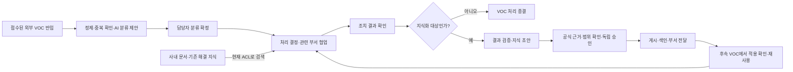

# Enterprise Knowledge Loop — VOC 중심 디자인 개선안

2026-10-18 · 사용자 피드백을 반영한 비교 시안 개정

## 제품의 중심

**접수된 VOC를 부서 간 협업으로 처리하고, 검증한 해결 경험을 사내 지식으로 만들어 다음 VOC 처리에 활용하는 시스템.**

첫 화면은 VOC 업무 공간이다. 문서 RAG·로컬 LLM은 담당자가 사내 문서와 유사 사례를 찾아 처리 결정을 내리는 데 사용한다. 검증한 결과를 지식으로 게시하면 다음 VOC의 참고 근거가 된다. 문서함에서 문서를 직접 게시·검색하는 기능과 독립 검색 화면도 계속 제공하되, 제품 소개와 기본 탐색에서는 VOC 처리 다음에 배치한다.

이전 비교안의 ‘질문 → ACL 변화 → VOC → 다시 질문’ 동선은 문서 질의가 제품의 중심이라는 인상을 주었다. 이번 개정은 **VOC 확인 → 처리 결정·협업 → 결과 확인 → 지식 검토·배포 → 다음 VOC 처리**를 중심으로 한다. ACL과 로컬 LLM은 이 업무를 뒷받침하는 공통 기반으로 설명한다.

검토 기준은 사용자가 지정한 단순화 프롬프트의 text 블록, Claude가 정리한 현행 기획서와 원본 HTML이다. 이번 산출물은 비교 시안과 개선안의 수정이다. 기존 루트 시안·기획서의 기능 명세를 확정 개정하는 작업은 별도로 남겨 둔다.

## 복잡성의 원인과 해결

| 우선순위 | 문제 | 이번 방향 |
|---|---|---|
| 1 | 제품의 중심 업무가 첫 화면에서 드러나지 않음 | VOC 목록과 선택한 문의의 다음 행동으로 시작 |
| 2 | 시스템 구성요소가 동일 위계의 메뉴로 나열됨 | 업무·지식·운영을 7개 메뉴로 묶고 역할에 맞게 표시 |
| 3 | AI 제안을 보는 동시에 모든 값을 편집해야 함 | 제안 전체를 읽기 전용으로 확인한 후 확정·수정 선택 |
| 4 | Case 단계·탭·각종 패널이 동시에 주의를 요구함 | 중앙은 현재 작업, 오른쪽은 협업 회신과 근거. 이력·원문은 상세 |
| 5 | 지식 게시 후 업무와의 연결이 약함 | 게시된 가이드 → 후속 VOC → 적용 사유·결과 → 처리 완료로 연결 |

업무의 필수 승인과 검증을 줄이지 않는다. 한 번에 보여 주는 의사결정과 탐색 선택지를 줄인다. 모든 VOC를 지식화할 필요도 없다.

## 전체 업무 흐름

QUICK은 기존 게시 지식의 적용 사유를 남겨 처리·종결한다. STANDARD는 협업·처리 결과를 남겨 종결한다. KNOWLEDGE는 검증 가능한 해결 경험을 초안·검토·게시로 연결한다. 부서 Task 완료, 메인 Case의 처리 결과, 지식 게시, 부서 전달은 각각 별도 상태로 유지한다.

## 메뉴 구조

| 순서·새 메뉴 | 기존 화면 | 주 사용자 |
|---|---|---|
| 1. VOC 처리 | S02 접수·분류, S03 Case, S13 내부 테스트 접수 | VOC 담당자·협업 부서 |
| 2. 내 업무 | S01 내 업무·현황 | 담당자·검토자·관리자 |
| 3. 지식·배포 | S04 지식 검토, S09 부서 지식함 | 작성·검토자, 지식 수신 부서 |
| 4. 문서함 | S14 문서함, S06 문서·지식 자산 | 문서 소유자·직원 |
| 5. 처리 지식 검색 | S05 문서·지식 질의 | VOC 담당자·직원 |
| 6. AI 운영 | S07 처리 흐름, S08 품질·운영, S12 배포 현황 | AI 운영자 |
| 7. 관리 | S10 조직·사용자, S11 권한·감사 | 조직·정책 관리자 |

전체 정의는 7개지만 사용자마다 필요한 메뉴만 보인다. 운영 관리자 권한만으로 업무 원문을 열 수는 없다. 독립 검색 화면은 유지하며, Case에서는 화면을 떠나지 않고 ‘이 VOC로 근거 더 찾기’를 이용할 수 있다.

## 화면별 행동과 배치

| 화면 | 주 행동 | 기본 표시 | 상세로 접기·다른 화면으로 이동 | 배치 |
|---|---|---|---|---|
| VOC 업무 공간 — 기본 입구 | 분류 확정하고 처리 | 상태별 목록, 선택 VOC 요지, 유형·긴급도·메인/관련 부서·처리 방법 | 수정 폼·원문·변경 이력 접기, 수집 실행은 AI 운영 | 왼쪽 처리 목록 / 오른쪽 선택 건과 다음 행동 |
| 내 업무 | 이어서 처리 | 분류 대기, 진행 Case, 검토·전달 상태 | 전체 운영 그래프는 AI 운영 | 해야 할 일 목록 → 부서 수신 지식 |
| Case | 현재 단계 완료 | 처리 결정 또는 결과 확인 폼, 부서별 회신, 참고 문서 | 원문·전체 Task 이력·권한 상세 접기 | 상단 진행 맥락 → 왼쪽 작업 / 오른쪽 협업과 근거 |
| 지식 검토 | 제출 또는 독립 승인·게시 | 본문, 공식 근거 확인, 공유 부서 | 범위 확대·원본 비교·버전 이력 상세 | 왼쪽 지식 본문 / 오른쪽 근거·배포 범위 |
| 문서함 | 문서 열기 | 제목·소유자·상태·버전 | 전체 ACL 규칙은 권한 상세, 조직 관리는 관리 메뉴 | 목록 → 문서 상세 → 필요 시 권한 변경 |
| 처리 지식 검색 | 근거 찾기 | 질문과 허용된 문서·지식의 출처 | 이전 질문·피드백 접기 | 질문 → 답변 → 출처. Case 안에서는 대화상자로 제공 |
| AI 운영 | 선택한 탭의 다음 조치 | 평가 관문·활성 구성 또는 선택한 처리/전달 상태 | 비교·피드백·세부 로그 접기 | 평가 / 처리 흐름 / 전달 탭 → 선택한 실행의 상세 |

분류 화면은 유형·긴급도·메인 부서·관련 부서·처리 경로의 다섯 제안을 확정 전에 모두 보여 준다. KNOWLEDGE Case에는 4단계 맥락만 보여 주고, QUICK·STANDARD에 승인·공유 단계를 강요하지 않는다. 화면 아래의 순환 설명은 탐색 탭이 아닌 짧은 설명이다.

## AI 제안과 사람 확정

| 패턴 | 방법 | 장점 | 유의점 |
|---|---|---|---|
| 기본: 요약 확인·명시적 확정 | 읽기 전용 AI 제안 → 제안대로 확정 / 수정 후 확정 | 대부분의 건에서 선택 상자 없이 처리 가능 | 확정 전에 제안값을 모두 보여 주고 확정자·시각을 기록 |
| 수정 시: 변경 비교·사유 | 원 AI 제안과 사람 변경값 비교 → 수정 사유 → 확정 | 담당 부서·처리 경로 변경을 추적하기 쉬움 | 전체 비교표는 처음부터 펼치지 않음 |

예제는 요약 확인과 수정 대화상자를 제공하고 AI 원 제안을 보존한다. 변경 항목을 나란히 보여 주는 상세 비교표는 원본 상세를 새 UI로 이식할 때 적용한다. 화면 이동·시연 버튼만으로 확정·승인을 대신하지 않는다.

## 권한을 보여 주는 순서

1. 일반 업무에서는 권한이 허용된 VOC·근거만 표시한다. 허용되지 않은 자료의 제목·건수·잠금 자리표시자를 만들지 않는다.
2. 문서 상세에서는 현재 열람 대상과 상속 여부를 요약한다.
3. 변경 시 대상·권한·사유를 먼저 입력하고 기간·상속 중단 등은 추가 설정에서 연다.
4. 범위 확대가 필요하면 기존/변경 범위를 검토하고 독립 승인한다. 승인 전 기존 권한을 유지한다.
5. 조직 겸직, 명시적 DENY, 상속 중단 지점, 감사 이력은 관리 상세에서 확인한다.

실제 접근 판정은 Spring Core가 수행한다. 검색·재정렬·LLM 입력·최종 출력·이전 답변 재열람에 현재 권한을 적용하며 ACL만 바뀐 경우 재색인을 기다리게 하지 않는다. Task 참여와 문서 열람권, 배포 대상 지정과 접근권 부여는 구분한다. 원문과 정제된 해결 지식의 권한도 각각 확인한다.

## VOC 중심 시연 동선

| 장면 | 역할·클릭 | 전달할 내용 |
|---|---|---|
| 1. 들어온 VOC | 담당자 → 목록 선택 → 제안대로 확정 | AI가 분류하고 사람이 처리 방향을 결정 |
| 2. 처리 | 부서 회신·문서 근거 확인 → 결정 사유 → 전후 결과 검증 | 사내 문서 RAG가 현재 VOC 처리를 지원 |
| 3. 지식 초안 | 초안 확인 → 공식 근거 확인 → 검토 제출 | 결과를 검증한 경험만 공식 지식 후보로 연결 |
| 4. 독립 검토 | 검토자 → 본문·근거·공유 범위 확인 → 승인·게시 | 작성과 승인을 분리, 색인·전달 상태도 구분 |
| 5. 부서 배포 | 담당자 → 부서 지식함 → 게시 버전 확인 | 승인된 부서에 활용 가능한 해결 가이드 전달 |
| 6. 재사용 | 다음 VOC에 활용 → 분류 확정 → 적용 사유·결과 입력 → 처리 완료 | 지식이 다음 VOC 해결로 돌아오는 순환 완성 |

3분 설명은 1) 문제·분류 30초, 2) 협업·근거·처리 60초, 3) 초안·독립 검토·배포 60초, 4) 후속 VOC 적용 30초를 목표로 한다. 전체 입력을 자세히 설명하는 시연은 더 길게 잡는다. 부서 회신은 미리 준비한 합성 데이터임을 명시한다. ‘시연 동선’은 역할과 장면만 바꾸며 필요한 확정·검증이 끝나기 전 다음 필수 장면으로 넘어가지 못한다.

ACL 변경 전후 검색 결과 비교, 조직 겸직, 수집 실패 재처리, 평가 관문·롤백은 질문을 받았을 때 보여 줄 추가 시연이다. 핵심 VOC 동선 앞에 필수 관문처럼 넣지 않는다.

## 시각 규칙

1. 작업 영역당 채워진 주 버튼 1개, 수정·이력·추가 근거는 보조 버튼.
2. 목록에서 주요 상태 1개를 우선 표시하고 ID·부서·유형은 일반 텍스트로 표시.
3. 동일 업무의 단계 바와 탭을 중복하지 않음.
4. 표는 기본 5열 이내, VOC 목록은 제목·소속·상태 중심으로 구성.
5. 본문 14px, 보조 정보 12px을 기본으로 제목·본문·설명 위계 구분.
6. 여백은 8/16/24px 단위, 업무 목록과 상세는 24px 간격.
7. 현행 원본의 하늘색 브랜드 유지, 성공·실패 색상은 상태에 한정.
8. 열람 인원·열람률 등 새 비용 지표를 추가하지 않음. VOC 필터 건수는 현재 표시 범위의 데이터에서만 계산.
9. 역할·겸직 전환은 ‘시안 설정’에 모으고 실제 업무 버튼과 구분.

## 예제 범위

- 가상 데이터로 VOC 분류, QUICK·STANDARD·KNOWLEDGE 처리, 문서 근거 검색, 결과 검증, 독립 검토·게시, 부서 전달, 후속 VOC의 정확한 지식 버전 활용을 연결했다.
- 협업 회신은 사전 준비한 예제다. 요청·수락·반송 등 모든 Task 동작은 원본 상세에서 비교한다.
- S01~S14 원본 상세는 별도 가상 상태로 열린다. 새 화면과 저장값이 동기화되지 않는다. 모든 원본 기능을 새 UI에 완전히 이식한 결과는 아니다.
- 서버 인증·ACL·DB·실제 수집·로컬 LLM·색인·감사 저장은 연결되지 않았다. 화면 점검은 보안 구현 검증이 아니다.
- 문서 직접 게시·RAG, 조직·겸직·ACL, AI 운영 기능은 유지한다. 이번 변경은 VOC 중심의 정보 배치와 시연 동선이다.
- 화면 캡처는 `screenshots/voc-*.png`, 최신 점검 결과는 `verification.json`을 사용한다. 이전 질문 중심 캡처는 이전 비교 기록이다.

이 구성을 확정한 뒤 원본 기획서 화면 정의와 세부 기능 이식 범위를 맞춘다. 개발 프롬프트는 기획 확정 후 작성한다.
