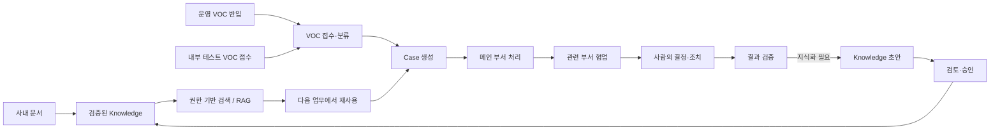
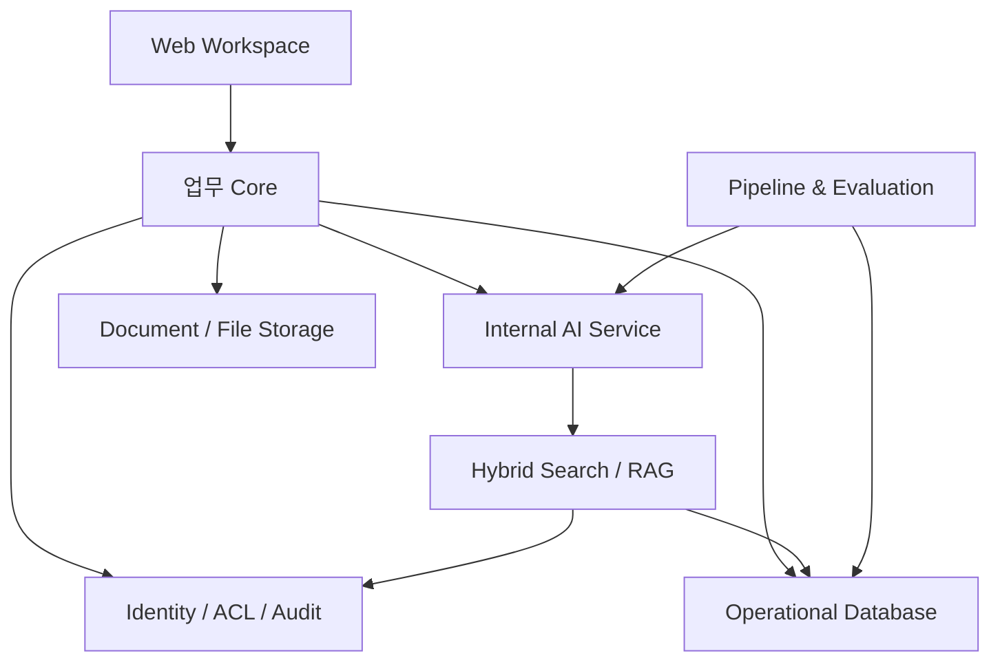

# Enterprise Knowledge Loop
## Concept & Composition v1

> **Git 1차 공개용 컨셉서**
>
> 이 문서는 프로젝트의 문제 정의, 제품 방향, 업무 흐름, 시스템 구성, 보안 원칙, MVP와 시연 범위를 설명한다.  
> DB 스키마, ER 모델, 테이블/컬럼, 상세 상태 모델, API 계약처럼 구현 종속적인 모델링 정보는 의도적으로 제외한다.

---

## 1. 프로젝트 한 줄 정의

**Enterprise Knowledge Loop는 사내 문서와 VOC 처리 경험을 사람이 검증한 기업 지식으로 전환하고, 사용자의 현재 권한 범위 안에서 AI가 안전하게 검색·추천·답변하며, 그 결과가 다시 새로운 지식으로 이어지는 엔터프라이즈 지식 순환 플랫폼이다.**

단순 RAG 챗봇이나 VOC 분석 대시보드가 아니라, 다음 두 흐름을 하나로 연결하는 것을 목표로 한다.

- **기존 지식 활용**: 규정, 매뉴얼, 기술 문서, 운영 문서 등을 검증·권한·버전 체계 안에서 AI가 활용
- **새로운 지식 생성**: VOC 처리 과정의 의견, 판단, 조치, 결과를 검증해 재사용 가능한 지식으로 전환

---

## 2. 왜 만드는가

기업에는 이미 많은 문서와 업무 경험이 있지만 실제 업무에서는 다음 문제가 반복된다.

- 매뉴얼과 VOC 처리 이력이 여러 시스템과 담당자에게 흩어져 있다.
- 비슷한 문제를 해결한 경험이 메일·메신저·담당자 기억 속에 남아 재사용되지 못한다.
- AI 답변이 어떤 문서와 어떤 버전을 근거로 했는지 불명확한 경우가 있다.
- 민감한 고객 정보나 부서 문서가 AI 검색 과정에서 넓게 노출될 수 있다.
- 처리 결과가 좋아도 공식 지식으로 정리되지 않아 다음 업무에서 다시 처음부터 조사한다.
- 문서를 배포한 뒤 실제로 어느 부서에 어떤 버전이 전달되었는지 추적하기 어렵다.

이 프로젝트는 **"검색 가능한 문서를 늘리는 것"보다 "근거와 책임이 분명한 지식이 다시 업무에 쓰이게 하는 것"**에 초점을 둔다.

---

## 3. 프로젝트 방향

### 3.1 AI는 제안하고 사람이 확정한다

AI는 다음을 지원한다.

- VOC 유형과 긴급도 제안
- 메인 부서와 관련 부서 제안
- 처리 경로 제안
- 권한 범위 내 관련 문서와 과거 사례 추천
- 답변 초안과 지식 초안 작성

하지만 최종 분류, 실제 처리 결정, 조치, 결과 검증, 공식 지식 승인은 사람이 담당한다.

**AI의 제안값과 사람의 확정값을 구분해서 다룬다.**

### 3.2 모든 VOC를 지식화하지 않는다

업무 특성에 따라 세 가지 처리 경로를 사용한다.

| 처리 경로 | 목적 | 대표 상황 |
|---|---|---|
| 바로 종결 | 기존 게시 지식으로 빠르게 해결 | 반복적인 사용 문의 |
| 일반 처리 | 업무 처리는 필요하지만 공식 지식까지 만들 필요는 없음 | 일회성 오류, 단순 협업 |
| 지식화 | 재사용 가치가 있는 해결 경험을 공식 지식으로 전환 | 반복 문제, 신규 문제, 다부서 협업 |

### 3.3 보안은 AI 기능 이후가 아니라 검색 이전부터 적용한다

사용자가 읽을 수 없는 자료는 AI의 검색 후보, 재순위화, 프롬프트 문맥, 답변 출처에 포함되지 않아야 한다.

핵심 원칙:

- 역할, 부서, 고객, 프로젝트, 보안등급, 객체별 ACL을 함께 고려
- 기본 거부(Default Deny)
- 원문과 정제된 지식의 접근 범위를 분리
- 협업 업무에 참여했다고 해서 원문이나 제한 문서 권한을 자동으로 확대하지 않음
- 지식 배포는 알림/전달이며 권한 부여 행위가 아님
- 권한 변경은 다음 검색부터 즉시 반영

### 3.4 AI는 내부 환경에서 동작한다

외부 AI API에 기업 문서와 VOC를 전달하지 않는 것을 기본 원칙으로 한다.

- 로컬 생성 모델
- 로컬 임베딩
- 로컬 Reranker
- 로컬 평가

---

## 4. 전체 업무 흐름



핵심 Loop:

**문서·VOC → AI 지원 → 사람의 판단 → 검증된 결과 → Knowledge → 권한 기반 RAG → 다음 업무 재사용**

---

## 5. VOC 유입 방식

실제 운영과 포트폴리오 시연을 분리하되, 이후 처리 흐름은 동일하게 사용한다.

### 운영 반입

기존의 외부 고객지원 채널, CRM, 메일, API 등의 기록을 Knowledge Loop로 가져온다.

```text
외부 채널 / 고객지원 시스템
        ↓
Connector / Import
        ↓
공통 반입 서비스
        ↓
정제 → AI 분석 → 분류 대기
```

### 내부 테스트 접수

기능 검증과 포트폴리오 시연을 위해 권한 있는 내부 사용자가 가상 VOC를 직접 입력한다.

```text
새 VOC 테스트 접수
        ↓
공통 반입 서비스
        ↓
정제 → AI 분석 → 분류 대기
```

테스트 접수는 고객용 공개 포털이 아니다.  
가상 데이터는 실제 고객 데이터와 구분해서 관리한다.

---

## 6. VOC 처리와 부서 협업

한 Case의 최종 책임은 **메인 부서 하나**가 가진다.

관련 부서의 도움이 필요한 경우 메인 부서가 협업 업무를 요청한다.

```text
VOC 접수·분류
      ↓
메인 부서 확정
      ↓
Case 생성
      ↓
메인 부서 처리
      ├── 관련 부서 A 협업 요청
      ├── 관련 부서 B 협업 요청
      └── 관련 자료 확인
      ↓
관련 부서 조사·의견·조치
      ↓
업무 완료 / 메인 부서로 회신
      ↓
메인 부서 결과 취합
      ↓
최종 결정 / 종결 또는 지식화
```

중요한 원칙:

- 관련 부서는 자신에게 요청된 협업 업무를 완료·회신한다.
- 전체 Case의 최종 종결은 메인 부서가 담당한다.
- 협업 요청과 권한 확대는 서로 다른 행위다.
- 관련 부서는 자기 권한 안에서만 원문·문서·지식을 확인한다.

---

## 7. 업무 중 참고 자료 활용

Case 처리 과정에서 담당자는 기존 문서와 게시된 Knowledge를 활용할 수 있다.

두 가지 방식으로 제공한다.

### AI 추천

현재 사용자의 권한 범위 안에서 AI가 관련 문서와 유사 사례를 추천한다.

### 직접 찾기

사용자가 검색을 통해 필요한 문서와 지식을 직접 찾는다.

시스템은 **AI가 추천한 자료**와 **사람이 실제로 참고하거나 적용한 자료**를 구분한다.

지식화 단계에서는 실제로 참고한 모든 자료를 자동 출처로 만드는 것이 아니라, 담당자와 검토자가 공식 근거로 사용할 자료를 다시 선택한다.

---

## 8. 지식화 흐름

지식화 경로에서는 처리 경험을 바로 공식 Knowledge로 만들지 않는다.

```text
VOC 처리
  ↓
부서 의견·근거
  ↓
사람의 최종 결정
  ↓
조치
  ↓
결과 검증
  ↓
AI 지식 초안
  ↓
공식 근거 선택
  ↓
내용 및 공유 범위 검토
  ↓
승인
  ↓
게시
  ↓
검색 색인
  ↓
부서 지식함 배포
  ↓
다음 업무에서 재사용
```

지식은 **초안 → 검토 → 승인 → 게시 → 폐기**의 생명주기를 가진다.

처리 완료와 지식 승인은 같은 의미가 아니다.

---

## 9. 원본 문서와 새 Knowledge의 권한

Case 처리 중 제한 문서를 참고했다고 해서 새 Knowledge의 권한이 자동으로 그 문서와 같아지거나, 반대로 원본 문서가 더 넓게 공개되어서는 안 된다.

원칙:

- 원본 VOC와 원본 문서의 권한은 유지
- 새 Knowledge는 별도 검토된 공유 범위를 가짐
- 제한 문서의 내용을 더 넓게 공유하려면 일반화·정제와 별도 승인 필요
- 사용자가 원본 Source를 읽을 권한이 없다면 제목, ID, 위치 등 민감한 Source 정보도 노출하지 않음

즉 **"원본을 보호하면서도 검증된 해결 절차는 필요한 범위에 재사용"**하는 것이 목표다.

---

## 10. 사용자 구성

| 사용자 | 주요 역할 |
|---|---|
| 일반 사용자 | 허용된 지식 검색, AI 답변 활용, 피드백 |
| 접수·분류 담당자 | VOC 반입/테스트 접수, AI 제안 확인, Case 생성 |
| 메인 부서 담당자 | Case 책임, 관련 부서 요청, 결과 취합, 최종 종결 |
| 관련 부서 담당자 | 요청받은 조사·의견·작업 수행 및 회신 |
| 검토자 / 승인자 | Knowledge 내용·근거·공유 범위 검토 및 승인 |
| 게시·배포 담당자 | 승인 지식 게시 및 대상 부서 전달 |
| 관리자 | 사용자·조직·권한 정책·운영 상태 관리 |

---

## 11. 주요 화면 구성

### 1) Knowledge Loop Overview

- 현재 진행 중인 VOC/Case
- 검토·승인 대기
- 게시 후 배포 상태
- 최근 Knowledge 재사용

### 2) VOC 접수·분류

- 운영 반입 VOC 목록
- 새 VOC 테스트 접수
- 원문/정제문 확인
- AI 유형·긴급도·메인 부서·처리 경로 제안
- 사람 확정 후 Case 생성

### 3) Case Workspace

- 접수 기록
- 협업 업무
- 부서 의견·결정
- 참고 자료
- 결과 검증
- 현재 처리 경로와 진행 상태

### 4) Knowledge Review

- 검증된 처리 결과
- AI 지식 초안
- 공식 근거 선택
- 공유 범위 검토
- 승인 / 반려 / 게시

### 5) Knowledge Search / RAG

- 권한 기반 검색
- 문서 + 게시 Knowledge 통합 검색
- 답변과 근거 출처 표시
- 접근 불가능한 Source는 비노출

### 6) 부서 지식함

- 게시·색인된 Knowledge의 부서별 배포
- 특정 버전 기준 전달
- 열람 확인

### 7) 문서·지식 자산

- 문서 등록·개정
- Knowledge 버전
- 공개 상태
- 소유 부서 및 권한 상태 확인

### 8) 권한·감사

- 사용자/부서/역할 기반 접근 정책
- 객체별 권한 확인
- 주요 접근·변경·승인 이력

---

## 12. 시스템 구성안



구성 방향:

- **업무 Core**: VOC, Case, 지식 검토, 배포, 업무 흐름
- **AI 서비스**: 분류, 요약, 추천, 임베딩, Reranker, 답변 생성
- **검색/RAG**: 키워드 검색 + 벡터 검색 + 재순위화
- **권한/감사**: 사용자 권한 판정, 검색 사전 필터, 접근 이력
- **파이프라인/평가**: 문서 처리, 색인, 품질 평가, 활성 구성 관리
- **저장소**: 문서 원본과 첨부 파일 보관

---

## 13. 기술 구성 방향

초기 구현 기준:

| 영역 | 방향 |
|---|---|
| 업무 Core | Java / Spring 기반 Modular Monolith |
| AI Service | Python / FastAPI |
| 업무 데이터 | PostgreSQL |
| 검색 | PostgreSQL FTS + pgvector 기반 Hybrid Search |
| 웹 | React / TypeScript |
| 파이프라인 | 실시간 이벤트 + Airflow 배치 |
| 평가 | MLflow 로컬 운영 |
| AI | Local LLM + Local Embedding + Local Reranker |
| 배포 | 초기 단일 노드, 이후 확장 가능 구조 |

기술은 목적이 아니라 **지식 순환과 보안 원칙을 검증하기 위한 수단**으로 사용한다.

---

## 14. MVP 범위

### 반드시 구현

- 사용자 인증과 업무 역할
- 사내 문서 등록 및 버전 관리
- 문서와 Knowledge의 권한 적용
- 운영 VOC 수동/CSV 반입
- 내부 VOC 테스트 접수
- 개인정보 정제와 원문 통제
- AI 분류·요약·부서·경로·참고 자료 제안
- 사람의 분류 확정과 Case 생성
- 세 가지 VOC 처리 경로
- 메인 부서 / 관련 부서 협업
- 사람 결정·조치·결과 검증
- Knowledge 초안·검토·승인·게시
- 권한 기반 Hybrid RAG
- 부서 지식함 배포
- 감사 및 AI 실행 이력
- 기본 품질·보안 평가와 롤백

### 후속 확장

- 메일·메신저 자동 연동
- 전화 상담 연동
- HWP/OCR 확대
- 모델 파인튜닝
- 카나리 배포
- 운영 N중화
- Kubernetes
- 다중 회사 SaaS

---

## 15. 포트폴리오 시연 시나리오

시연은 3개의 가상 VOC로 처리 경로의 차이를 보여준다.

### A. 바로 종결

**"비밀번호 초기화 메일이 오지 않습니다."**

기존 게시 Knowledge 추천 → 사람이 적용 확인 → 즉시 종결 → Knowledge 재사용 기록

### B. 일반 처리

**"PDF 다운로드 시 표가 깨져 보입니다."**

고객지원팀 처리 → 필요 시 개발팀 협업 → 결과 취합 → 종결  
공식 Knowledge는 만들지 않음

### C. 지식화

**"업데이트 이후 문서 검색이 8초 이상 걸립니다."**

```text
새 VOC 테스트 접수
→ 개인정보 정제
→ AI 분류/부서/경로/관련 자료 제안
→ 사람 확정
→ Case 생성
→ 관련 부서 협업
→ 권한 기반 문서 참고
→ 사람 결정
→ 조치
→ 결과 검증
→ Knowledge 초안
→ 근거/공유 범위 검토
→ 승인·게시·색인
→ 부서 배포
→ 다음 유사 VOC에서 RAG 재사용
```

이 시나리오 하나로 다음을 보여준다.

- AI 추천과 사람 확정의 분리
- 실제 부서 협업
- 문서 ACL을 지키는 AI 추천
- 검증된 Outcome 이후의 지식화
- 게시 Knowledge의 재사용
- 사용자 권한에 따라 달라지는 RAG 결과

---

## 16. 성공 기준

### 기능

- VOC 테스트 접수부터 Knowledge 재사용까지 전체 Loop가 동작
- 기존 문서와 Case 기반 Knowledge를 함께 검색
- 관련 부서 협업이 Case 종결까지 이어짐
- 모든 VOC가 지식화되지 않고 세 경로가 구분됨

### 보안

- 권한 없는 문서/Knowledge가 검색 후보와 AI 문맥에 포함되지 않음
- 원문과 정제 지식의 권한 분리
- 협업 요청만으로 원문/문서 권한이 확대되지 않음
- 권한 회수 후 다음 검색부터 즉시 반영

### AI 품질

- 근거가 없는 경우 답변을 억지로 생성하지 않음
- 답변에 정확한 게시 버전의 출처 표시
- AI 분류/추천과 사람 확정 결과 비교 가능
- 사용자 피드백을 평가 개선에 활용

---

## 17. 프로젝트 메시지

> **기업 문서를 AI로 검색하는 데서 끝나지 않고, 업무 과정에서 새롭게 생긴 판단과 처리 결과까지 사람이 검증한 지식으로 만들고 다시 업무에 활용한다.**
>
> **AI는 사용자의 현재 권한 안에서만 일하고, 판단은 사람이 확정하며, 검증된 결과만 기업의 공식 지식이 된다.**
