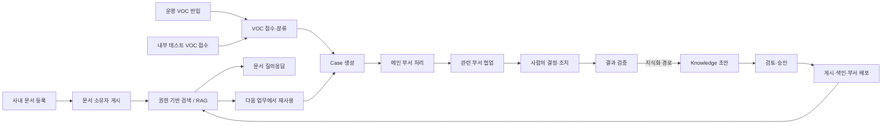
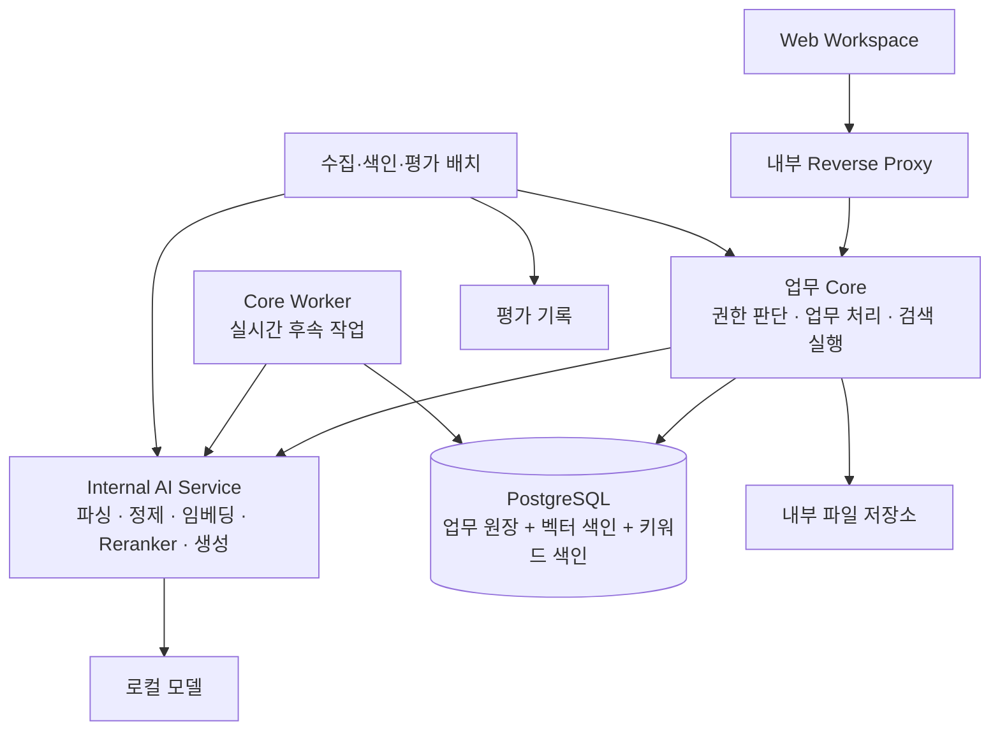

# enterprise-knowledge-loop
## Enterprise Knowledge Loop — Concept & Composition v1

> **공개용 컨셉서**
>
> 이 문서는 프로젝트의 문제 정의, 제품 방향, 업무 흐름, 시스템 구성, 보안 원칙, MVP와 시연 범위를 설명한다.  
> DB 스키마, ER 모델, 테이블/컬럼, 상세 상태 모델, API 계약처럼 구현 종속적인 모델링 정보는 의도적으로 제외한다.

---

## Repository Navigation

이 문서는 Git 저장소 **`enterprise-knowledge-loop`**의 공개용 컨셉서다.

- Repository root: `enterprise-knowledge-loop/`
- README: [`../README.md`](../README.md)
- Concept Markdown: `docs/Enterprise_Knowledge_Loop_Concept_and_Composition_v1.md`
- Concept DOCX: [`./Enterprise_Knowledge_Loop_Concept_and_Composition_v1.docx`](./Enterprise_Knowledge_Loop_Concept_and_Composition_v1.docx)
- UI Prototype: [`../prototype/enterprise-knowledge-loop-prototype.html`](../prototype/enterprise-knowledge-loop-prototype.html)
- System Architecture: [`../architecture/architecture.svg`](../architecture/architecture.svg)

저장소 구조:

```text
enterprise-knowledge-loop/
├─ README.md
├─ docs/            # 컨셉서 (md, docx)
├─ prototype/       # UI 프로토타입 (단일 HTML)
├─ design/          # 프로토타입 원본 (HTML, CSS·JS, 로고)
└─ architecture/    # 시스템 구성도
```

---
## 1. 프로젝트 한 줄 정의

**Enterprise Knowledge Loop는 사내 문서에 바로 묻는 문서 LLM과 VOC RAG 파이프라인을 하나의 로컬 RAG·LLM 기반 위에 구축하는 엔터프라이즈 지식 순환 플랫폼이다. 기업의 권한(ACL)을 검색과 AI 답변까지 그대로 적용하고, VOC 처리 경험은 사람이 검증한 기업 지식으로 만들어 다음 업무에서 다시 쓴다.**

단순 RAG 챗봇이나 VOC 분석 대시보드가 아니라, 다음 두 흐름을 같은 검색·권한·평가 기반 위에서 하나로 연결하는 것을 목표로 한다.

- **기존 문서 활용(문서 질의응답)**: 직원은 자기가 읽을 수 있는 게시 문서에 바로 질문하고, 정확한 문서 버전 출처가 붙은 답을 받는다.
- **새로운 지식 생성(VOC 처리)**: VOC 처리 과정의 의견, 판단, 조치, 결과를 사람이 검증해 재사용 가능한 지식으로 만든다.

두 흐름은 같은 색인, 같은 권한 사전 필터, 같은 평가 관문을 쓴다. VOC를 처리할 때 AI가 추천하는 참고 자료에는 게시 문서와 게시 지식이 함께 나온다.

---

## 2. 왜 만드는가

기업에는 이미 많은 문서와 업무 경험이 있지만 실제 업무에서는 다음 문제가 반복된다.

| 현재 문제 | 제공할 기능 | 확인할 변화 |
|---|---|---|
| 매뉴얼과 VOC 처리 이력이 흩어져 있다 | 문서·Case 기반 Knowledge 통합 검색 | 같은 문제에서 문서와 승인된 사례를 함께 찾는다 |
| 처리 방법이 담당자 기억에 의존한다 | 결정 사유·대안·검증 결과 기록 | 다른 부서가 조치의 이유와 한계를 이해한다 |
| 답변의 신뢰성과 최신성이 불분명하다 | 게시 버전·출처·담당자·재검토 기한 관리 | 폐기된 지식과 구버전이 답변 근거에서 빠진다 |
| 민감한 고객 정보가 넓게 공유된다 | 원문 접근 제한, 정제된 지식의 승인, ACL | 원본에 접근하지 않고 허용된 처리 절차만 재사용한다 |
| 문서를 전달한 뒤 반영 여부를 알 수 없다 | 부서 지식함, 버전 고정 배포, 열람 확인 기록 | 누구에게 어느 버전이 전달됐는지 조회한다 |
| 외부 AI로 데이터가 반출될 우려가 있다 | 로컬 추론·임베딩·재순위화·평가 | 외부 통신을 차단한 상태에서 전체 흐름이 동작한다 |

이 프로젝트는 **"검색 가능한 문서를 늘리는 것"보다 "근거와 책임이 분명한 문서와 지식이 다음 질문과 다음 업무에서 다시 쓰이게 하는 것"**에 초점을 둔다.

단순 문의까지 모두 의견 수집·검증·승인·게시를 거치면 업무가 무거워진다. 실제 VOC 대부분은 이미 답이 있는 문의다. 그래서 기존 지식으로 답할 수 있는 문의는 가볍게 종결하고, 새로운 문제·반복 문의·여러 부서가 얽힌 문제만 지식화한다.

---

## 3. 핵심 원칙

| 원칙 | 의미 |
|---|---|
| 1. 문서 RAG와 VOC 파이프라인 통합 | 사내 문서 검색과 VOC 처리를 하나의 제품·업무 흐름·지식 체계로 운영한다 |
| 2. 사내 문서 + VOC 통합 지식 순환 | 처리 방안과 결과를 문서화하고, 사람이 검증하고, 부서에 재배포하고, 다음 업무에서 재사용한다 |
| 3. ACL을 검색과 AI 답변까지 적용 | 열람·검색·재순위화·프롬프트·답변·출처 표시 모두에 권한을 적용한다. 권한이 바뀌면 재색인 없이 다음 질문부터 반영한다 |
| 4. 로컬 LLM, 외부 반출 제한 | 외부 AI API와 외부 임베딩·재순위화·평가 서비스를 쓰지 않는다 |
| 5. 평가 없이 바꾸지 않는다 | 모델·프롬프트·파이프라인 변경은 평가셋 관문을 통과해야 활성화하고, 언제든 이전 구성으로 롤백한다 |
| 6. 사람의 피드백으로 개선한다 | 현업의 피드백과 결정을 모아, 사람이 검증한 것만 평가셋에 반영한다 |

### 3.1 AI는 제안하고 사람이 확정한다

AI는 업무의 여섯 지점에서 일한다. 모든 지점은 그 순간 사용자의 현재 권한 안에서만 동작하고, 어느 지점에서도 AI는 제안만 하며 확정은 사람이 한다.

| AI 접점 | 쓰는 사람 | AI가 하는 일 | 사람이 확정하는 것 |
|---|---|---|---|
| 문서 질의응답(문서 LLM) | 모든 직원 | 지금 읽을 수 있는 게시 문서·게시 지식만 검색해 근거 있는 답변과 정확한 버전 출처를 준다 | 답변을 쓸지 정하고 피드백을 남긴다 |
| 분류 제안 | 접수·분류 담당자 | VOC의 유형·긴급도·메인 부서·처리 경로·관련 부서를 제안한다 | 분류값과 처리 경로를 확정하고 Case를 만든다 |
| 유사 사례·지식 추천 | 담당자 | 읽을 수 있는 게시 문서·게시 지식만 관련도 순으로 보여 준다 | 실제로 참고·적용할 자료를 고른다 |
| 근거 있는 답변 초안 | 담당자 | 읽을 수 있는 근거만으로 답변을 만든다. 근거가 없으면 답하지 않는다 | 답변을 쓸지, 고칠지, 버릴지 정한다 |
| 지식 초안 | 담당자·검토자 | 검증된 Case와 결과로 지식 초안을 만든다 | 공식 근거를 고르고 내용을 고친 뒤 검토·승인한다 |
| 평가·피드백 | 현업 사용자·AI 운영 담당 | 고정 평가셋으로 모델·프롬프트·파이프라인을 채점하고 피드백을 모은다 | 피드백을 평가 항목으로 승격할지, 관문을 통과한 구성을 활성화·롤백할지 정한다 |

**AI의 제안값과 사람의 확정값은 따로 저장한다.** AI 장애가 접수·의견 작성·사람 결정을 막지 않는다.

### 3.2 모든 VOC를 지식화하지 않는다

업무 특성에 따라 세 가지 처리 경로를 사용한다. 경로는 AI가 제안하고 담당자가 확정한다. 처리 경로는 기록 부담만 바꾸고, 보안 규칙은 모든 경로에 같다.

| 처리 경로 | 목적 | 대표 상황 |
|---|---|---|
| 바로 종결 | 허용된 게시 지식으로 빠르게 해결 | 이미 답이 있는 반복 문의(대부분) |
| 일반 처리 | 업무 처리는 필요하지만 공식 지식까지 만들 필요는 없음 | 일회성 오류, 단순 협업 |
| 지식화 | 재사용 가치가 있는 해결 경험을 공식 지식으로 전환 | 새 문제, 반복 문의, 여러 부서가 얽힌 문제 |

- 처리 중 더 무거운 경로로 올리는 것은 언제든 가능하다. 가벼운 경로로 내리는 것은 지식 초안 제출 전까지만, 사유와 함께 할 수 있다.
- 근거 없는 유사 문의가 반복되거나 여러 부서 협업으로 끝난 Case는 시스템이 "지식화 후보"로 표시한다. 자동으로 초안을 만들거나 게시하지 않는다.
- 바로 종결의 처리 결과는 검증을 거치지 않았으므로 지식의 출처가 될 수 없다.

### 3.3 보안은 AI 기능 이후가 아니라 검색 이전부터 적용한다

사용자가 읽을 수 없는 자료는 AI의 검색 후보, 재순위화, 프롬프트 문맥, 답변 출처, 지식 초안 어디에도 들어가지 않는다. 그런 자료가 있다는 사실(제목, ID, 건수)도 드러내지 않는다.

핵심 원칙:

- 역할(RBAC), 보안등급·부서·고객·프로젝트 같은 속성(ABAC), 객체별 ACL을 함께 판단
- 기본 거부(Default Deny): 명시적으로 허용되지 않으면 볼 수 없다
- 검색할 때부터 읽을 수 있는 자료만 대상으로 삼는 사전 필터. 검색 후 걸러 내는 방식에만 의존하지 않는다
- 권한은 문서·지식의 원장에만 두고, 검색 색인은 그 권한을 참조만 한다. 그래서 권한이 바뀌면 재색인 없이 다음 질문부터 검색과 답변이 바뀐다
- 생성 중에 권한이 회수되면 그 근거는 응답에 남지 않는다
- 권한 판단은 모두 업무 Core 서버가 한다. AI 서비스와 DB는 권한을 판단하지 않는다
- 원문과 정제된 지식의 접근 범위를 분리
- 협업 업무에 참여했다고 해서 원문이나 제한 문서 권한을 자동으로 확대하지 않음
- 지식 배포는 알림·전달이며 권한 부여 행위가 아님
- 지식 작성자·제출자는 자기 제출본을 승인할 수 없음
- 접근·변경·승인과 AI 실행 이력을 남김

### 3.4 AI는 내부 환경에서 동작한다

외부 AI API에 기업 문서와 VOC를 전달하지 않는다. 모든 AI 연산을 사내 장비에서 처리한다.

- 로컬 생성 모델
- 로컬 임베딩
- 로컬 Reranker(재순위화 모델)
- 로컬 평가

---

## 4. 전체 업무 흐름



핵심 Loop:

**문서·VOC → AI 지원 → 사람의 판단 → 검증된 결과 → Knowledge → 권한 기반 RAG → 다음 질문과 다음 업무에서 재사용**

---

## 5. 사내 문서와 문서 질의응답

사내 문서는 지식화를 거치지 않고도 바로 문서 질의응답의 대상이 된다.

```text
문서함에 문서 등록 (적용될 권한 미리보기)
        ↓
원본·권한 저장 → 파싱·정제
        ↓
문서 소유자가 공식 문서로 확인 (문서 게시)
        ↓
청킹·임베딩·색인
        ↓
문서 질의응답 + VOC 처리의 참고 자료로 사용
```

- **올리기만 한 문서는 검색되지 않는다.** 문서 소유자가 공식 문서임을 확인(게시)해야 색인된다. 새 버전을 게시하면 이전 버전은 검색에서 빠진다.
- **문서함은 폴더로 권한을 정리한다.** 폴더는 만들 때 소유 부서·보안등급의 기본 권한을 받고, 그 안의 하위 폴더와 문서는 폴더 권한을 상속한다. 특정 문서에만 다른 권한을 주는 예외는 사유가 필요하고, 기본보다 넓히는 예외는 별도 승인을 받는다.
- **권한 설정은 네 단계다.** 보기·다운로드·편집·관리 중에서 고르고, 높은 단계는 낮은 단계를 포함한다. 저장 전에 새로 보게 되는 사람과 못 보게 되는 사람을 미리 보여 준다.
- **폴더 권한을 바꾸면 다음 질문부터 답이 바뀐다.** 문서 색인은 문서의 현재 권한을 따르므로 재색인이 필요 없다.
- 문서를 정리·일반화해 부서에 전달할 공식 지식으로 만들고 싶을 때만 지식화를 요청한다.

---

## 6. VOC 유입 방식

실제 운영과 포트폴리오 시연을 분리하되, 이후 처리 흐름은 동일하게 사용한다. 두 방식 모두 같은 반입 서비스를 거친다. 고객 접수 화면이나 CRM은 새로 만들지 않는다.

### 운영 반입

기존의 외부 고객지원 채널, CRM, 메일, API 등에 이미 접수된 기록을 Knowledge Loop로 가져온다. MVP는 수동·CSV 반입으로 시작한다.

```text
외부 채널 / 고객지원 시스템
        ↓
Connector / Import
        ↓
공통 반입 서비스
        ↓
원문 제한 저장 → 개인정보 정제 → 중복 검사 → AI 분석 → 분류 대기
```

### 내부 테스트 접수

기능 검증과 포트폴리오 시연을 위해 권한 있는 내부 사용자가 가상 VOC를 직접 입력한다.

```text
새 VOC 테스트 접수
        ↓
공통 반입 서비스
        ↓
원문 제한 저장 → 개인정보 정제 → 중복 검사 → AI 분석 → 분류 대기
```

테스트 접수는 고객용 공개 포털이 아니다.  
가상 데이터는 실제 고객 데이터와 구분해서 관리하고, 화면에는 "시연용 가상 VOC" 배지로 표시한다.

화면에는 연락처 같은 개인정보를 가린 정제문을 기본으로 보여 주고, 원문은 별도 권한이 있는 사람만 본다.

---

## 7. VOC 처리와 부서 협업

한 Case의 최종 책임은 **메인 부서 하나**가 가진다.

관련 부서의 도움이 필요한 경우 메인 부서가 협업 업무(의견·작업·검토)를 요청한다.

```text
VOC 접수·분류
      ↓
메인 부서 확정
      ↓
Case 생성
      ↓
메인 부서 처리
      ├── 관련 부서 A 협업 요청
      ├── 관련 부서 B 협업 요청
      └── 관련 자료 확인
      ↓
관련 부서 수락·조사·의견·조치
      ↓
업무 완료 / 메인 부서로 회신
      ↓
메인 부서 결과 취합
      ↓
최종 결정 / 종결 또는 지식화
```

중요한 원칙:

- 관련 부서는 자신에게 요청된 협업 업무를 완료·회신한다. 맡기 어려우면 사유를 적어 메인 부서로 돌려보낸다.
- 전체 Case의 최종 종결은 메인 부서가 담당한다. 필수 협업 업무가 끝나지 않으면 종결할 수 없다.
- 협업 요청과 권한 확대는 서로 다른 행위다.
- 관련 부서는 자기 권한 안에서만 원문·문서·지식을 확인한다.
- 협업 업무는 Case 종결 전의 부서 간 요청·회신이고, 지식 배포는 게시 후의 지식 링크 전달이다. 둘을 섞지 않는다.

---

## 8. 업무 중 참고 자료 활용

Case 처리 과정에서 담당자는 게시 문서와 게시 Knowledge를 활용할 수 있다.

두 가지 방식으로 제공한다.

### AI 추천

현재 사용자의 권한 범위 안에서 AI가 관련 문서와 유사 사례를 추천한다.

### 직접 찾기

사용자가 검색을 통해 필요한 문서와 지식을 직접 찾는다.

시스템은 **AI가 추천한 자료**와 **사람이 실제로 참고하거나 적용한 자료**를 구분한다.

지식화 단계에서는 실제로 참고한 모든 자료를 자동 출처로 만드는 것이 아니라, 담당자와 검토자가 공식 근거로 사용할 자료를 다시 선택한다.

---

## 9. 지식화 흐름

지식화 경로에서는 처리 경험을 바로 공식 Knowledge로 만들지 않는다. 화면에는 **접수 → 처리 → 승인 → 공유** 4단계로 표시하고, 승인 이후의 게시·색인·부서 전달은 자동으로 이어진다.

| 단계 | 사람이 하는 일 | 자동 처리 |
|---|---|---|
| 접수 | AI 제안 확인 → 분류 확정, Case 생성 | 반입(또는 테스트 접수), 원문 제한 저장, 정제, AI 분석 |
| 처리 | 관련 부서 협업 요청·회신 취합, 결정 저장, 결과·증거 입력 후 검증 | 검증이 끝나면 AI 지식 초안 생성, 배포 대상 부서 제안 |
| 승인 | 담당자가 초안·공식 근거·배포 대상을 확인해 제출 → (공유를 넓힐 때만) 원본 소유 측·정책 승인 → 승인자 "승인하고 게시" | 확대 승인 요청을 동시에 보내고, 모두 끝나면 승인자에게 넘김 |
| 공유 | 없음 | 게시 → 검색 색인 준비 → 대상 부서 지식함 전달 |

사람이 거치는 관문은 **결정, 결과 검증, 승인** 세 가지와, 공유 범위를 넓힐 때의 추가 승인뿐이다.

규칙:

- **배포 대상도 승인 대상이다.** 담당자가 제출할 때 배포 대상 부서를 확정하고, 대상이 바뀌면 승인은 다시 받아야 한다. 읽기 권한이 없는 부서는 제출 단계에서 막는다.
- **색인이 준비되어야 전달된다.** 검색 색인이 실패하면 배포는 대기하고 운영 화면에서 재시도한다.
- **열람 확인은 기본으로 요청하지 않는다.** 확인이 필요한 배포만 승인할 때 요청을 켠다.
- **처리 완료와 지식 승인은 같은 의미가 아니다.** 긴급한 업무 조치는 검토 중인 초안과 별개로 진행할 수 있다.

게시된 지식은 소유 부서가 정한 재검토 기한에 다시 확인하고, 폐기하면 즉시 검색 대상에서 빠진다. 새 버전을 게시하면 이전 버전은 검색에서 빠지고, 배포 링크도 현재 상태에 맞는 안내로 바뀐다.

---

## 10. 원본 문서와 새 Knowledge의 권한

Case 처리 중 제한 문서를 참고했다고 해서 새 Knowledge의 권한이 자동으로 그 문서와 같아지거나, 반대로 원본 문서가 더 넓게 공개되어서는 안 된다.

원칙:

- 원본 VOC와 원본 문서의 권한은 유지
- 새 Knowledge는 별도 검토된 공유 범위를 가짐
- 제한 문서의 내용을 더 넓게 공유하려면 일반화·정제와 원본 소유 측·정책 승인이 필요
- 사용자가 원본 Source를 읽을 권한이 없다면 제목, ID, 위치 등 민감한 Source 정보도 노출하지 않음
- 일반화된 지식을 읽을 수 있어도 원본 VOC 링크는 따로 권한을 검사

즉 **"원본을 보호하면서도 검증된 해결 절차는 필요한 범위에 재사용"**하는 것이 목표다.

---

## 11. 조직 변경과 권한

부서의 신설·이름 변경·이동·통합·분할·폐지는 단순 정보 갱신이 아니라 권한에 영향을 주는 변경으로 다룬다.

- 조직 변경은 **영향 미리보기 → 승인 → 적용** 순서로 처리한다. 미리보기에는 영향을 받는 자료 수와 새로 보게 되는 사람·못 보게 되는 사람 수가 나온다.
- 폐지·통합·분할된 부서의 자료는 승계 부서가 책임을 이어받는다. 책임은 승계되지만 열람 범위는 자동으로 넓어지지 않는다.
- 조직 동기화에서 한 번에 바뀌는 양이 기준을 넘으면 적용을 보류하고 사람이 확인한다.
- 본직과 겸직은 구분해서 권한을 계산한다.

---

## 12. 사용자 구성

| 사용자 | 주요 역할 |
|---|---|
| 일반 사용자 | 허용된 문서·지식 질의, 출처 열람, AI 답변 피드백 |
| 담당자(메인 부서) | VOC 반입·테스트 접수·분류 확정, Case 생성·처리, 관련 부서 협업 요청, 결과 취합·종결, 지식 제출 |
| 관련 부서 담당자 | 요청받은 협업 업무의 수락·조사·의견·조치 및 회신 |
| 의견 작성자 | 배정된 Case의 의견·근거 작성 |
| 검토자 / 승인자 | Knowledge 내용·근거·공유 범위·배포 대상 검토, 승인하고 게시 |
| 문서 소유자 | 문서 등록·개정·게시, 폴더·문서 권한 설정 |
| 관리자 | 사용자·조직·권한 정책 관리, 평가 실행·활성화·롤백 |

- 한 사람에게 여러 역할을 줄 수 있지만, 제출자와 승인자는 반드시 다른 사람이어야 한다.
- 업무 역할 외에 보안등급과 부서·고객·프로젝트 범위를 함께 검사한다.
- 관리 역할만으로는 원문이나 다른 부서 자료를 읽을 수 없다. 관리자도 자기 자료 접근 범위를 직접 넓히지 못한다.

---

## 13. 주요 화면 구성

업무 화면은 14개로 구성한다. 모든 화면에서 권한 없는 자료는 목록·건수에도 나타나지 않는다.

| 화면 | 목적 |
|---|---|
| S01 지식 순환 현황(내 업무) | AI 제안 대기, 내 업무, 지식화 후보, 재검토 기한을 한눈에 본다 |
| S02 VOC 접수·분류 | 원문/정제문 확인, AI 제안 확인과 사람 확정, Case 생성 또는 바로 종결 |
| S03 Case 작업 공간 | 관련 부서 협업, 참고 자료 기록, 결정·결과 검증, 종결 |
| S04 지식화 검토 | 초안을 원본과 대조하고 공식 근거·배포 대상과 함께 제출·승인 |
| S05 문서·지식 질의(AI) | 게시 문서와 게시 지식에 질문해 근거와 출처가 붙은 답변을 받고 피드백 |
| S06 지식·문서 자산 | 상태별 지식 목록, 버전과 출처, 후속 Case 연결, 폐기 |
| S07 수집·처리 흐름 | 수집·처리 작업의 단계와 계보, 실패 단계 재실행 |
| S08 품질·운영 | 평가 실행과 관문 판정, 활성화·롤백, 모델 비교, 피드백 검토 |
| S09 부서 지식함 | 부서에 배포된 지식 수신, 열람 확인, 실패 부서 재배포 |
| S10 권한·감사 | 부서 기본 권한, 객체 예외, 변경·접근 이력 |
| S11 조직·사용자 연동 | 조직 트리·직원·발령 동기화, 조직 변경 미리보기·승인 |
| S12 배포 현황 대시보드 | 지식이 필요한 부서에 닿았는지, 어디서 막혔는지 확인 |
| S13 새 VOC 테스트 접수 | 시연·검증용 가상 VOC를 입력해 실제 반입 흐름 실행 |
| S14 문서함 | 문서 업로드·새 버전·게시, 폴더 정리, 폴더·문서 권한 설정 |

---

## 14. 시스템 구성안



구성 방향:

- **업무 Core**: 권한 판단, VOC·Case·지식 검토·배포 업무, 검색 실행. 사용자는 Core만 호출한다
- **Core Worker**: 게시 후 색인 요청, 부서 배포 전달, 권한 변경 전파 같은 실시간 후속 작업
- **AI 서비스**: 파싱, 개인정보 정제, 분류·요약, 임베딩, 질의 토큰화, Reranker, 답변 생성. 권한 판단과 검색 실행은 하지 않고 결과를 Core에 돌려준다
- **검색/RAG**: 키워드 검색 + 벡터 검색 + 순위 결합 + 재순위화. 업무 원장과 두 검색 색인이 같은 DB에 있어, Core가 계산한 허용 범위를 검색 조건에 바로 넣는다. 권한 판단과 검색 사이에 시차가 없다
- **파이프라인/평가**: 문서 수집·색인 배치, 고정 평가셋 실행, 평가 관문, 활성 구성 관리와 롤백
- **저장소**: 문서 원본과 정제문 보관
- AI·DB·파일 저장소·모델 포트는 브라우저에 노출하지 않는다

---

## 15. 기술 구성 방향

초기 구현 기준:

| 영역 | 방향 |
|---|---|
| 업무 Core | Java / Spring 기반 Modular Monolith |
| AI Service | Python / FastAPI (내부 전용) |
| 업무 데이터 | PostgreSQL |
| 검색 | PostgreSQL FTS(키워드) + pgvector(벡터) Hybrid Search, RRF 결합, 로컬 Reranker |
| 한국어 처리 | 로컬 형태소 분석기 Kiwi로 검색 토큰 생성 |
| 웹 | React / TypeScript |
| 파이프라인 | 실시간 업무 이벤트(outbox + Core worker) + Airflow 배치 |
| 평가 | 고정 평가셋, 평가 관문·롤백, MLflow 로컬 기록 |
| AI | 로컬 생성 모델 + 로컬 임베딩 + 로컬 Reranker |
| 파일 저장 | 저장 어댑터, MVP는 로컬 볼륨 |
| 배포 | MVP는 단일 노드, 이후 N중화 가능한 구조 |

- 생성 모델은 소형·중형·MoE 세 후보를 같은 평가셋으로 비교해 기본 운영 모델을 고른다.
- 개발·검증은 기존 데스크톱 장비 한 대로 진행하며, 신규 장비 구매를 전제로 하지 않는다.
- 별도 키워드 검색 엔진(OpenSearch + nori)은 같은 평가셋에서 FTS보다 유의미하게 좋을 때만 도입을 검토한다.

기술은 목적이 아니라 **지식 순환과 보안 원칙을 검증하기 위한 수단**으로 사용한다.

---

## 16. MVP 범위

### 반드시 구현

**파이프라인**

- 문서 질의응답(문서 LLM): 게시 문서의 색인과 질의, 정확한 문서 버전·위치 출처
- 운영 VOC 수동/CSV 반입, 내부 VOC 테스트 접수, 개인정보 정제와 원문 통제
- AI 분류·요약·메인 부서·관련 부서·처리 경로·참고 자료 제안과 사람 확정
- 세 가지 VOC 처리 경로, 지식화 후보 감지
- 메인 부서 / 관련 부서 협업, 참고 자료 기록
- 사람 결정·조치·결과 검증
- Knowledge 초안·공식 근거 선택·검토·승인·게시·폐기, 승인 후 자동 부서 배포, 열람 확인
- 권한 기반 Hybrid RAG와 정확한 버전 출처 표시
- 고정 평가셋(검색·답변·분류 품질과 권한 누출·인젝션 같은 보안 항목), 평가 관문·활성화·롤백
- AI 답변·초안·분류 피드백 수집과, 사람이 검토한 피드백의 평가 항목 승격
- 생성 모델 3개 후보 비교와 기본 운영 모델 선정
- 감사 및 AI 실행 이력, 데이터 계보

**파이프라인이 쓰는 기반**

- 사용자 인증과 업무 역할, 조직·직원·겸직 연동
- 역할·속성·ACL 기반 권한 판단, 부서 기본 권한·상속·객체 예외
- 문서함: 폴더 생성·이동·삭제, 문서 업로드·새 버전·게시·폐기, 폴더 권한 상속
- 폴더·문서 권한 설정 패널과 저장 전 영향 미리보기, 넓히는 변경의 별도 승인
- 조직 변경 처리: 승계 부서 지정과 적용 전 영향 미리보기
- 배포 현황 대시보드
- 14개 한국어 업무 화면

### 구현 단계

| 단계 | 제공 가치 |
|---|---|
| 공통 기반 | 재현 가능한 개발 환경, 첫 기능부터 인증·권한·감사 적용 |
| 1단계 Mini 고리 | 문서 등록·게시 → 문서 질의 1회, VOC 접수 → Case → 지식 → 배포 → 재사용 1회를 끝까지 연결 |
| 2단계 파이프라인 + 평가셋 | 수집·색인을 반복 실행하고 품질을 처음 잰다 |
| 3단계 검색 품질 + 내부 LLM | Hybrid 검색·Reranker 적용, 기본 모델 확정 |
| 4단계 피드백 | 현업 피드백이 검토를 거쳐 평가셋으로 돌아온다 |
| 5단계 릴리스 관문 | 평가 없이 바뀌지 않는 운영. 여기까지가 MVP 완료 |

개발 기한은 고정하지 않는다. 단계별 기능·검증 완료 조건을 확인한 뒤 다음 단계로 넘어간다.

### 후속 확장

- 메일·메신저 업무 기록 연동 (MVP에서는 인터페이스만 정의)
- 전화상담·실시간 상담 연동
- 연결기 확대, HWP/OCR, 기존 문서 관리 시스템 연동
- 조직 변경 고도화 (일괄 소유권 이관, 신규 부서 초기 재배포)
- 모델 파인튜닝(QLoRA 등)과 카나리 배포
- 운영 N중화 구현
- 운영 규모 확대 (추론 서버·작업 큐·분산 배포)

### 제외

고객용 공개 포털과 고객 접수 화면, CRM·고객센터 시스템 전체 구현, 고객에게 자동 답장, 자동 업무 실행 Agent, 인터넷 검색, 외부 LLM, Kafka/Kubernetes 운영, 대형 모델 학습, 다중 회사 SaaS. 문서함은 범용 문서 관리 시스템이 아니다.

---

## 17. 포트폴리오 시연 시나리오

시연은 문서 질의 1건과 3개의 가상 VOC로 권한 적용과 처리 경로의 차이를 보여준다.

### 문서 질의

운영팀 직원이 **"검색 지연 시 점검 순서"**를 묻는다.

운영팀 폴더의 게시된 운영 매뉴얼을 근거로, 매뉴얼 버전과 위치를 붙여 답한다.  
같은 질문을 영업팀 직원이 하면 "확인된 근거가 없습니다"로 답하고, 매뉴얼이 있다는 사실도 드러나지 않는다.  
운영팀 폴더에 영업팀 보기 권한을 더하고 승인하면, 재색인 없이 다음 질문부터 영업팀 직원의 답에도 매뉴얼이 근거로 나온다.

### A. 바로 종결

**"비밀번호 초기화 메일이 오지 않습니다."**

기존 게시 Knowledge 추천 → 사람이 적용 확인 → 즉시 종결 → Knowledge 재사용 기록

### B. 일반 처리

**"PDF 다운로드 시 표가 깨져 보입니다."**

고객지원팀 처리 → 필요 시 개발팀 협업 → 결과 취합 → 종결  
공식 Knowledge는 만들지 않음

### C. 지식화

**"업데이트 이후 문서 검색이 8초 이상 걸립니다."**

```text
새 VOC 테스트 접수
→ 개인정보 정제
→ AI 분류/부서/경로/관련 자료 제안
→ 사람 확정
→ Case 생성
→ 관련 부서 협업
→ 권한 기반 문서 참고
→ 사람 결정
→ 조치
→ 결과 검증
→ Knowledge 초안
→ 근거/공유 범위/배포 대상 검토
→ 승인하고 게시
→ 색인 준비 후 부서 지식함 자동 전달
→ 다음 유사 VOC에서 RAG 재사용
```

이 시연으로 다음을 보여준다.

- 권한이 바뀌면 재색인 없이 문서 질의 결과가 바뀜
- AI 추천과 사람 확정의 분리
- 실제 부서 협업
- 문서 ACL을 지키는 AI 추천
- 검증된 Outcome 이후의 지식화
- 게시 Knowledge의 재사용
- 사용자 권한에 따라 달라지는 RAG 결과

---

## 18. 성공 기준

### 기능

- VOC 테스트 접수부터 Knowledge 재사용까지 전체 Loop가 동작
- 게시된 사내 문서에 바로 질문해 근거 있는 답을 받음
- 기존 문서와 Case 기반 Knowledge를 함께 검색
- 관련 부서 협업이 Case 종결까지 이어짐
- 모든 VOC가 지식화되지 않고 세 경로가 구분됨
- 테스트 접수와 운영 반입이 같은 반입 서비스를 씀

### 보안

- 권한 누출 테스트 0건. 읽을 수 없는 근거의 제목·ID·건수가 응답과 화면 어디에도 나타나지 않음
- 원문과 정제 지식의 권한 분리
- 협업 요청만으로 원문/문서 권한이 확대되지 않음
- 권한을 회수·확대한 직후 같은 질문에서 재색인 없이 검색 결과와 답변이 바뀐 권한을 따름
- 외부 AI 호출 0건

### AI 품질

- 근거가 없는 경우 답변을 억지로 생성하지 않음
- 답변에 정확한 게시 버전의 출처 표시
- AI 분류/추천과 사람 확정 결과 비교 가능
- 평가 관문을 통과하지 않은 구성은 활성화되지 않고, 이전 구성으로 즉시 롤백 가능
- 사람이 검토해 승인한 피드백만 평가 항목이 됨
- 품질 목표(예: 검색 Recall@5 0.80)는 주장하는 값이 아니라 측정해 확인할 목표로 둠

---

## 19. 공개본에서 의도적으로 제외하는 내용

이 문서는 **컨셉서 + 구성안**이다.

다음 내용은 구현 설계 문서에서 별도로 관리하며, 이 공개본에는 포함하지 않는다.

- DB 스키마
- 테이블/컬럼 정의
- ER 모델 / ERD
- 상세 관계 모델
- 정확한 ACL 저장 구조
- ACE/Policy 내부 필드
- 상태 전이 테이블
- 상세 API Endpoint / Request / Response
- 이벤트/Outbox 상세 Schema
- 검색 인덱스 내부 Schema
- Airflow DAG 상세 설계
- 클래스/패키지 구조
- 상세 Sequence Diagram
- 마이그레이션 설계

목적은 공개 저장소에서 **"무엇을 만들고 왜 만드는지, 어떻게 구성할 것인지"**를 이해할 수 있게 하는 것이다.

---

## 20. 프로젝트 메시지

> **기업 문서를 AI로 검색하는 데서 끝나지 않고, 업무 과정에서 새롭게 생긴 판단과 처리 결과까지 사람이 검증한 지식으로 만들고 다시 업무에 활용한다.**
>
> **AI는 사용자의 현재 권한 안에서만 일하고, 판단은 사람이 확정하며, 검증된 결과만 기업의 공식 지식이 된다.**
