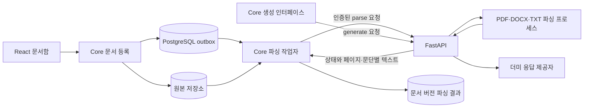
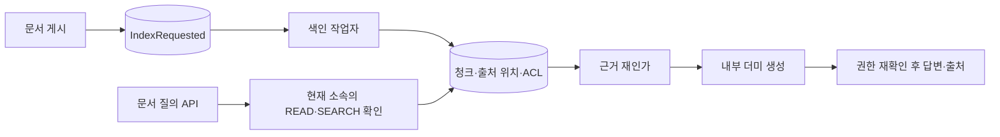
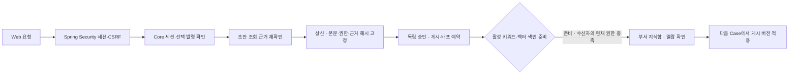

# EKL 개발 내역과 회고 자료

기능별로 당시 요구사항, 구현 경계, 검증 근거를 기록한다. 회고를 작성할 때는 [회고 작성 프롬프트](retrospective-prompt.md)에서 기능 이름을 지정하고 이 문서의 해당 항목을 함께 제공한다.

## 전체 아키텍처

설계 기준 전체 구성이며 내부 모델의 실제 구동은 전체 검토 후 적용한다.

[배포 구성도](../architecture/arch-2.svg)는 초기 설계의 목표 배치다. 현재 개발 환경은 Web·Core·AI를 별도 로컬 프로세스로 실행하고 PostgreSQL은 WSL Docker에서 실행한다.

## 이전 구현

| 기능 | 요구사항과 구현 결정 | 검증 근거와 남은 범위 |
|---|---|---|
| Core 기반 | 단일 저장소의 `core/` 안에 `com.ekl.framework`, `com.ekl.common`, `com.ekl.core`를 배치했다. Gradle Kotlin DSL과 Version Catalog로 의존성을 관리한다. Service·BLO·DAO 구현체를 인터페이스로 주입하고 Service의 트랜잭션과 Log4j2 호출 기록은 AOP로 적용했다. | `2c7966d` 및 [Core 통합 시험](../core/src/test/java/com/ekl/core/CoreBootstrapTest.java). 시험에는 Flyway, DB 세션, 롤백, 입력값 로그 제외가 있다. 권한 선언 자동 검증과 독립 작업자 배치는 후속이다. |
| 문서·폴더 | DB 세션의 현재 업무 소속과 ACL을 기준으로 목록과 단건을 조회한다. 폴더 생성·이름 변경·보관, 문서 등록·버전·게시·게시 해제·폐기, 업로드 권한 미리보기를 구현했다. | `2c7966d`, `9a88938` 및 [Core 통합 시험](../core/src/test/java/com/ekl/core/CoreBootstrapTest.java). 기존 시험의 파싱 완료 상태는 SQL로 설정했다. ACL 편집·폴더 이동과 검색 권한 회수 연동은 후속이다. |
| Web 공통과 문서함 | 프로토타입을 기준으로 React·TypeScript·Vite를 도입하고 공통 컴포넌트의 상태를 스타일 가이드에 정리했다. API 데이터는 TanStack Query, 작업 탭 상태는 Zustand로 관리한다. 로그인·업무 소속·문서함을 연결했다. | `9a88938` 및 [Web 흐름 시험](../web/e2e/web.spec.ts). 업무 흐름 시험은 Core 응답을 모의 처리하고 스타일 가이드는 반응형·키보드 상호작용을 검사한다. |
| VOC·Case | 수동 VOC 원문은 별도 저장하고 정제된 내용만 업무 상세에 제공한다. 새 Case로 분류하고 사람 결정·종결 결과를 기록한다. | `9a88938` 및 Core·Web 시험. Core 시험의 VOC 정제 상태는 SQL로 설정했다. AI 분류, 기존 Case 연결, 협업 Task, AI 지식화 설정은 후속이다. |
| 지식·배포 | 근거 지정 초안 생성·수정·폐기, 배포 요청과 수신 확인·재전달 API까지 연결했다. | `2c7966d`, `9a88938` 및 Core 통합 시험. 합의·최종 승인, 색인 이후 자동 전달과 부서 지식함은 후속이다. |

## 이번 구현 — 문서 파싱과 LLM 호출 계약

- **작업 경계** — Core는 원본을 읽고 해시를 확인한 후 서비스 인증으로 AI에 전송한다. AI는 구조화한 파싱 결과를 반환하고 Core가 문서 버전 상태와 작업 상태를 함께 반영한다. 등록 이벤트와 파싱 결과의 대상은 불변인 문서 버전 ID로 연결한다.
- **실패 처리** — 작업자는 `SKIP LOCKED`로 작업을 가져와 임대 토큰을 부여한다. 통신 실패는 제한적으로 재시도하고, 임대가 바뀐 작업자의 결과는 반영되지 않는다. 파서가 읽을 수 없는 문서는 품질 실패, 본문 텍스트가 없는 PDF는 OCR 필요로 기록한다.
- **LLM 결정** — 전체 검토 후 로컬 모델을 선택한다. 지금은 동일한 HTTP 계약을 통해 `DUMMY` 응답을 받는다. 이 경로를 질의 화면이나 업무 결과에 연결하는 작업은 후속이다.
- **근거** — [내부 API 계약](../contracts/core-ai.openapi.json), [파싱 작업자](../core/src/main/java/com/ekl/core/job/blo/DocumentParseBloImpl.java), [AI HTTP 시험](../ai/tests/test_internal_api.py).
- **검증** — AI 시험 5개, Core PostgreSQL 통합 시험 7개와 Java 생성 계약 시험 1개가 통과했다. AI 시험은 UTF-8 TXT, DOCX, 텍스트 PDF, 텍스트 없는 PDF, 서비스 인증·nonce·deadline과 더미 생성을 확인한다. 로컬 통합 환경에서 Web 프록시로 TXT를 업로드해 문서 상태가 `PARSED`로 바뀌는 것을 확인했다. 브라우저에서 실제 계정으로 로그인해 문서함의 파싱 완료 상태와 스타일 가이드를 열었다.
- **다음 작업** — 파싱 결과를 청킹·색인하는 `IndexRequested` 처리, VOC 정제와 분류, 문서·지식 질의 화면 연결.

## Web 시안 대조와 화면 정리

- **기준** — 두 HTML을 브라우저에서 열어 비교하고, Web 개발 프롬프트에서 지정한 [VOC 업무 흐름 시안](../prototype/enterprise-knowledge-loop-workflow.html)의 메뉴 순서, 맑은 고딕 14px, 녹색 선택 상태와 간격을 적용했다.
- **구현** — 업무 홈은 현재 업무 소속으로 Core가 반환한 VOC·Case 목록을 사용한다. VOC 수신함과 문서함은 목록을 먼저 보여 주고 선택 후 상세를 연다. 연결 전 지식 메뉴에는 준비 상태를 표시한다. 스타일 가이드의 목차에서 업무 화면으로 이동할 수 있다.
- **검증** — 실제 로그인 환경과 HTML 시안에서 메뉴 이름·순서와 적용 글꼴을 대조했다. 업무 홈·VOC 수신함·문서함·스타일 가이드는 1440px·1024px·390px에서 확인했다. [Web 검증 시나리오](../web/e2e/web.spec.ts)

## Core 문서 색인과 질의

- **색인과 회수** — 현재 게시 버전의 파싱 결과만 색인한다. 청크와 색인 포인터는 같은 트랜잭션에 저장한다. 게시 회수와 버전 교체 시 기존 포인터는 즉시 검색에서 제외되고, 작업자가 이전 색인 상태를 정리한다.
- **검색 경계** — Core가 현재 소속과 폴더 상속 정책에서 얻은 허용 자원·ACL로 후보 SQL을 제한한다. PostgreSQL 키워드 검색 상태는 `degraded`로 표시하며, 생성은 더미 HTTP 계약을 사용한다. 질문 원문과 근거 본문 대신 질문 해시와 출처 ID를 기록한다.
- **검증** — Core PostgreSQL 통합 시험 7개와 Java AI HTTP 계약 시험 1개가 통과했다. 게시 후 색인 전에는 근거가 없고, 색인 후에는 문서 버전·문단 근거가 표시됐다. 테스트 DB에서 요청자에 대한 폴더 검색 제외 규칙을 적용한 뒤 같은 색인으로 다시 질의해 근거가 사라지는지 확인했다. [Core 통합 시험](../core/src/test/java/com/ekl/core/CoreBootstrapTest.java)

## 이미지 시안 기반 Web 개편

- **시안** — 로컬에 보관한 기능별 이미지와 컴포넌트 시트 기준으로 상단 탐색, 기본 본문 16px, 줄간격 1.6, 주요 섹션 간격 32px, 조작 영역 44px을 적용했다.
- **구현** — 내 업무의 문의 제목에서 VOC 접수 상세 또는 Case 처리로 이동한다. 접수 분류는 정제된 내용 아래에서 확정하고, Case는 처리 기록을 읽은 다음 별도 입력 화면에서 결과를 작성한다. 문서 질의는 Core의 답변과 문서 버전·위치를 표시하며, 더미 생성과 근거 없음 상태를 구분한다.
- **검증** — Web 빌드, Vitest 2개, Core 응답을 모의한 Playwright 3개가 통과했다. Case를 1366×768, 1920×1080, 390×844에서 열어 가로 넘침을 확인했다. [Web 검증 시나리오](../web/e2e/web.spec.ts)

## Web 화면 원복 후 문서 질의와 지식 초안 연결

- 이미지 시안 적용 전 로컬 Web 스냅샷의 파일 72개를 해시 검증 후 복원했다. 시안 변경본은 별도 로컬 ZIP에 보관했다.
- 문서함의 게시 버전에서 버전과 위치를 주 근거로 지정해 지식 초안을 저장한다. 같은 작성 창에서 저장한 초안의 본문을 수정하며 서버가 반환한 revision으로 동시 변경을 확인한다.
- 문서·지식 질의는 Core가 보낸 출처의 문서 버전과 위치를 표시한다. 출처 링크는 문서 상세 조회를 거쳐 현재 읽기 권한을 다시 적용한다. 근거 없음, 권한 변경, 답변 준비 실패를 각각 안내한다.
- Core 응답을 모의한 브라우저 시험에서 문서 게시 → 초안 생성·본문 수정, 질의 출처 열기, 업무 소속 전환 후 근거 미표시를 확인했다. [Web 검증 시나리오](../web/e2e/web.spec.ts)

## 세션 필터와 문서 기반 지식 결재·배포

- 세션 만료와 발령 회수를 다른 오류로 반환한다. Web은 현재 세션을 다시 조회하고 이전 업무 소속의 화면 데이터를 정리한다.
- 문서 기반 지식의 작성자가 상신하면 소유 부서의 독립 최종 승인을 요청한다. 보완 요청이나 반려는 해당 배포 계획을 취소한다. 배포 작업자는 준비된 지식만 받아 유효 발령과 READ를 확인한 사람에게 수신 근거를 만든다.
- Core 통합 시험에서 자기 승인 거부, 보완 뒤 재상신, 멱등 승인, 색인 준비 전 수신 없음과 준비 뒤 전달·열람 확인을 검증했다. 검색 인덱스는 시험 DB에서 준비 상태를 공급했다. 실제 지식의 키워드·벡터 색인 생성, Case 기반 병렬 합의, 확대 승인·재전달 작업은 후속 범위다.
- Web 브라우저 시험에서 초안 재열기·상신과 업무 소속 재선택·만료 세션의 로그인 화면 이동을 확인했다. [Core 통합 시험](../core/src/test/java/com/ekl/core/CoreBootstrapTest.java) · [Web 검증 시나리오](../web/e2e/web.spec.ts)
